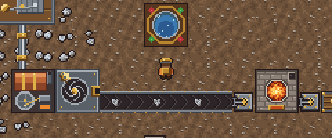

<p align="center">
  
</p>

<p align="center">
  <b>A cozy pixel-art factory game with Create-style rotational power and online co-op for up to 4 players.</b><br>
  Mine ore, smelt it, craft machines, and turn the whole world with water wheels, shafts and gears.
</p>

<p align="center">
  <a href="https://github.com/wumgub/cogworks/releases/latest"></a>
  
  
  <a href="LICENSE"></a>
</p>

<p align="center">
  
</p>

---

## Install

Pick your platform and paste one line. It downloads the latest release, installs it for your user (no admin or
sudo needed), and starts the game.

**macOS** (Apple Silicon and Intel) and **Linux** (x86-64): paste into Terminal

```sh
curl -fsSL https://raw.githubusercontent.com/wumgub/cogworks/main/install.sh | sh
```

**Windows** 10/11: paste into PowerShell

```powershell
irm https://raw.githubusercontent.com/wumgub/cogworks/main/install.ps1 | iex
```

<details>
<summary><b>Prefer to download it yourself?</b></summary>

Grab the archive for your system from the [latest release](https://github.com/wumgub/cogworks/releases/latest):

| File | What to do |
|---|---|
| `Cogworks-macOS.zip` | Unzip, then drag **Cogworks.app** to Applications. The first time, **right-click → Open** (the app isn't notarized by Apple yet). |
| `Cogworks-Windows.zip` | Unzip anywhere and run **Cogworks.exe**. If SmartScreen appears, choose **More info → Run anyway**. |
| `Cogworks-Linux.tar.gz` | `mkdir cogworks && tar -xzf Cogworks-Linux.tar.gz -C cogworks && ./cogworks/Cogworks.x86_64` |

**Uninstall:** delete `~/Applications/Cogworks.app` (macOS), `%LOCALAPPDATA%\Cogworks` plus its shortcuts
(Windows), or `~/.local/share/cogworks`, `~/.local/bin/cogworks` and
`~/.local/share/applications/cogworks.desktop` (Linux).
</details>

---

## What you'll be doing

<table>
  <tr>
    <td width="50%"></td>
    <td width="50%"></td>
  </tr>
  <tr>
    <td><b>Build a factory.</b> Drills chew through ore patches, conveyor belts carry it to furnaces, and
    inserters shuffle items between machines. Belts even carry you if you step on them.</td>
    <td><b>Explore an endless world.</b> Seeded terrain with lakes, beaches, grassland and rich patches of
    iron, copper, coal and stone. The minimap (top right) shows what's nearby.</td>
  </tr>
  <tr>
    <td></td>
    <td></td>
  </tr>
  <tr>
    <td><b>Power it like Create.</b> Machines need <i>rotation</i>. Hand cranks, water wheels and steam engines
    drive networks of shafts and gearboxes, and shafts can run over belts. Every machine adds stress; overload a
    network and it grinds to a halt (look for the red cog).</td>
    <td><b>Craft everything.</b> Hand-craft from your inventory, or set up assemblers to make gears, circuits,
    belts and science packs for you. Click any building to look inside and move items in or out.</td>
  </tr>
  <tr>
    <td></td>
    <td></td>
  </tr>
  <tr>
    <td><b>Research new tech.</b> Feed science packs into labs to unlock assemblers, splitters, underground belts,
    steam power, green science and fast belts.</td>
    <td><b>Play your way.</b> Survival-style progression or a free-building <b>Sandbox</b>. Autosaves every five
    minutes, and the host's save carries the whole multiplayer world.</td>
  </tr>
</table>

---

## Multiplayer

Up to **4 players** build in the same world, in real time. Each player gets their own engineer color, and
anyone can drop in while the game is running.

<p align="center">
  <br>
  <sub>The host's view: four engineers (orange, blue, green, purple) working the same factory. Top left: "LAN host · 4/4 players".</sub>
</p>

<p align="center">
  <br>
  <sub>The same moment from player 3's machine: "Connected · player 3". Every player's world stays identical.</sub>
</p>

### Playing on the same network (LAN)

1. **Host:** on the main menu, click **Host LAN Game**. To continue an existing world, tick
   *Host my saved world* first.
2. **Find the host's IP:** on the host's computer,
   - **macOS:** System Settings → Wi-Fi → Details → IP address
   - **Windows:** run `ipconfig` and look for *IPv4 Address*
   - **Linux:** run `hostname -I`
3. **Friends:** type that IP (for example `192.168.1.42`) into the box next to **Join LAN** and click it.
   Add `:port` if the host changed it from 7777.
4. On Windows, allow Cogworks through the firewall the first time it asks.

### Playing over the internet

Cogworks connects directly to the host, so friends outside your home network need one of these:

- **Easiest: a free virtual LAN.** Everyone installs [Tailscale](https://tailscale.com/) (or ZeroTier, or
  Radmin VPN) and joins the same network. The host shares their Tailscale IP (`100.x.y.z`) and friends use
  **Join LAN** with it. No router setup needed.
- **Port forwarding:** the host forwards **UDP port 7777** on their router to their computer. Friends then
  join with the host's public IP (search "what is my IP").

> **Join codes** (Host Online / Join by Code) use Unity Relay and are coming in a future release. For now, use
> LAN, a virtual LAN, or port forwarding.

### How it stays in sync

The host runs the authoritative simulation. Every action (placing, removing, crafting) becomes a command
that the host stamps with a tick and broadcasts, so every computer runs the exact same deterministic
simulation. Players who join late receive a compressed snapshot of the world. If a player ever drifts, the
host notices the mismatched world hash within a second and quietly resends the world.

---

## How to play

| Input | Action |
|---|---|
| **WASD** · scroll wheel | Move · zoom |
| **1–9, 0** | Pick a building (others: click them in the inventory) |
| **Left click / drag** | Place (drag lays a line; belts turn corners automatically) |
| **Left click** with no tool | Open a building · hold on ore to mine by hand |
| **Right click / drag** | Remove (refunds the building and its contents) |
| **R** / **Shift+R** | Rotate |
| **Q** | Drop the tool, or copy the building under the cursor |
| **E** | Crank a hand crank |
| **Tab** · **T** · **M** | Inventory and crafting · research · minimap zoom |
| **F1** · **F5** · **Esc** | Full guide · save · pause menu |

**A good first hour**

1. Hold left click on ore to mine some **stone**, **iron** and **coal** by hand.
2. Press **Tab**: stone makes **furnaces**. Furnaces smelt ore into plates when given coal.
3. Put a **drill** on iron ore, a **water wheel** by water (or a **hand crank**, press E), and join them with
   **shafts**. The drill starts spinning.
4. Point the drill at a furnace (or run a belt plus inserter), and plates start piling up.
5. Craft **science packs**, build a **research lab**, press **T**, and unlock the assembler.

The in-game **How to Play** guide (F1) covers power, logistics and research in more detail.

---

## Building from source

1. Install **Unity 6.6** (6000.6.5f1) with Unity Hub, plus Windows/Linux Build Support if you want those builds.
2. Clone the repo (it uses **Git LFS** for images: `git lfs install` first), then open the folder in Unity.
3. Open `Assets/_Game/Scenes/Main.unity` and press Play. **Cogworks → Build Main Scene** rebuilds the scene from code.
4. All art is original and generated by Python (Pillow and numpy): `python3 Tools/art/generate.py` writes every
   sprite, the UI skin and the pixel font (a tiny hand-rolled TrueType writer turns pixel glyphs into outlines).

```
Assets/_Game/
  Sim/     Deterministic simulation in plain C# (no UnityEngine): world gen, buildings, belts, kinetic
           networks, items, recipes, research, players, commands, save snapshots
  Net/     Host, client and local sessions over an abstract transport (lockstep with desync recovery)
  View/    Rendering, animation, HUD and panels; input becomes commands
  Game/    Netcode for GameObjects glue, menus, saves, command-line test harness
  Tests/   EditMode tests for the simulation and networking (77)
Tools/art/ Art, UI skin and font generators
```

**Testing:** run the EditMode tests in Unity's Test Runner. The player also has a headless soak-test mode, where
a host and clients issue random commands and log world hashes that must match:

```
Cogworks -batchmode -nographics -cw-mode host -cw-port 7777 -cw-autotest 45 -cw-log host.txt -cw-sandbox
Cogworks -batchmode -nographics -cw-mode client -cw-ip 127.0.0.1 -cw-port 7777 -cw-autotest 45 -cw-log c1.txt
```

## Roadmap

- Online join codes through Unity Relay
- Fluids and pipes, trains, more machine tiers
- Music, and more sound
- Dedicated server mode

## License

Cogworks (code, art and the Cogworks Pixel font) is free software under the
[GNU General Public License v3.0](LICENSE).
